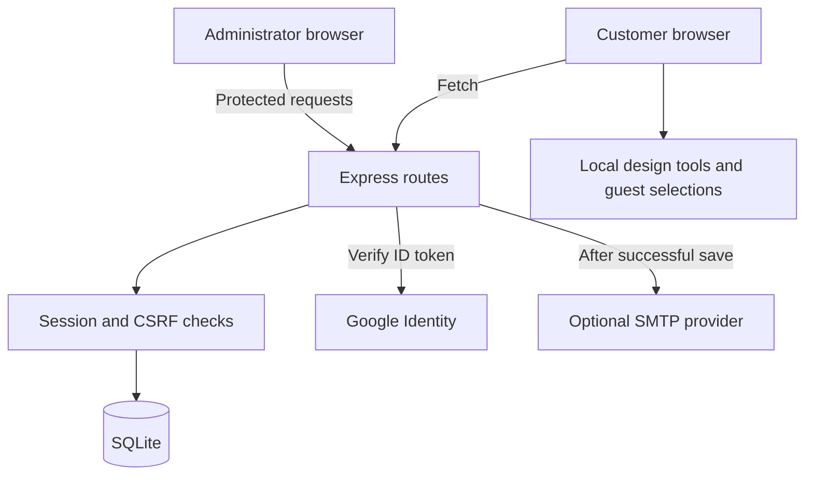
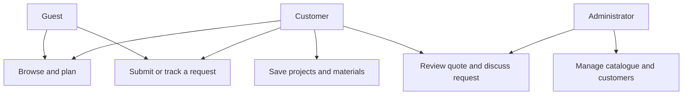
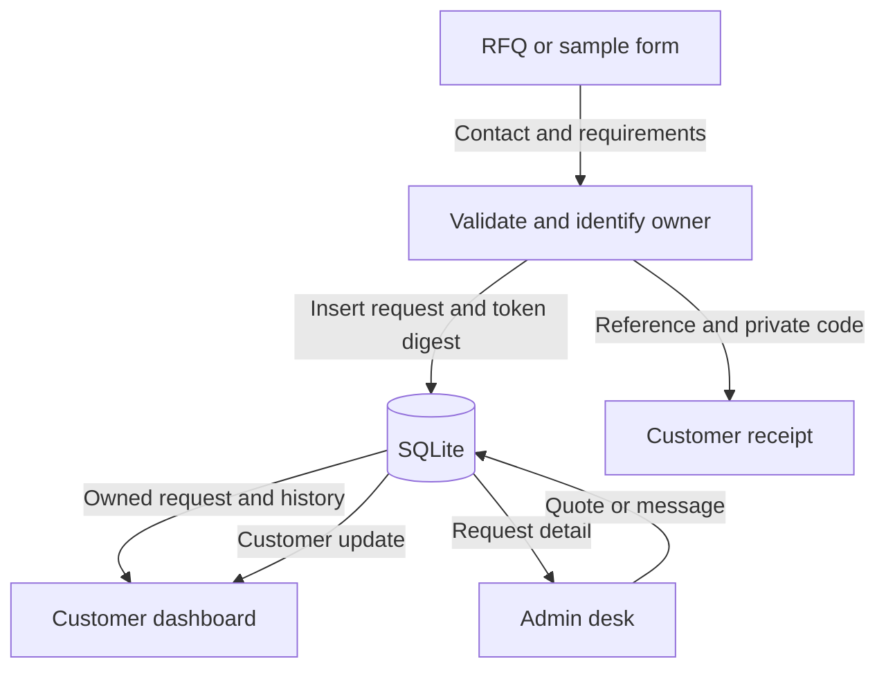
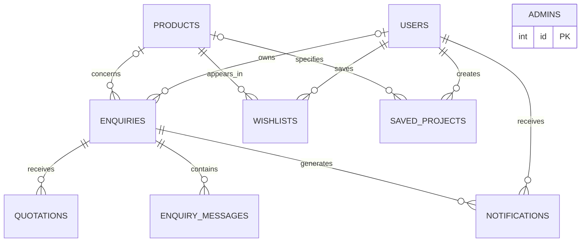
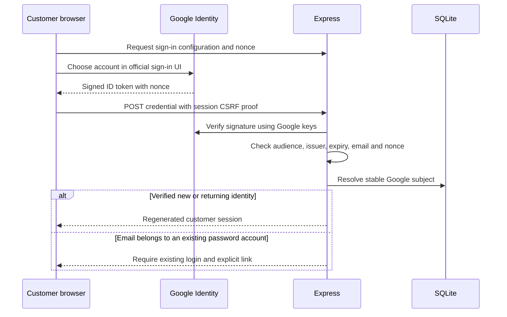
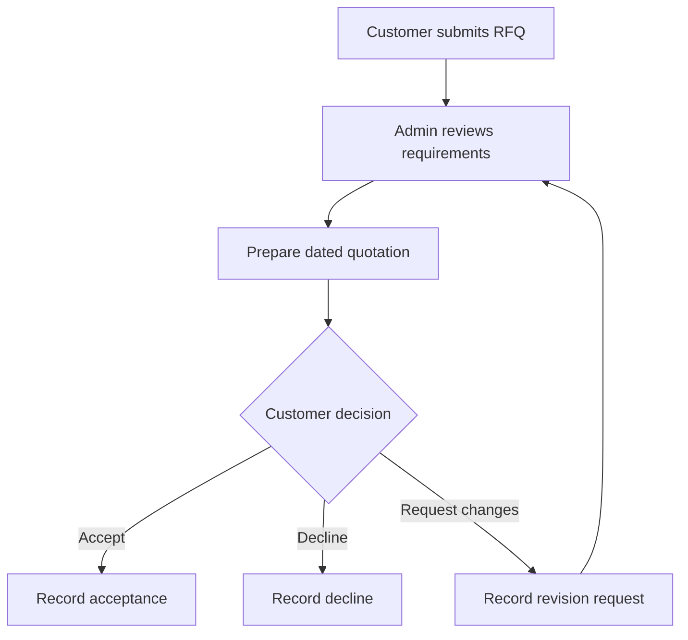
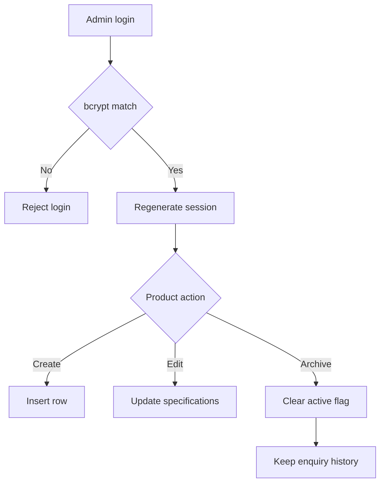

# Jineshwar Stone Impex

A local full-stack catalogue, planning studio and customer enquiry desk built with HTML, CSS, vanilla JavaScript, Express and SQLite. A customer can compare finishes, estimate material, submit a request, discuss it with the studio and respond to a quotation. The administrator manages the same records the customer sees.

The original business website directed visitors to contact channels. This project gives each request a reference, history and owner while preserving guest access. Verified phone numbers, address, founder information, services and social channels are documented in [REFERENCE.md](REFERENCE.md). The ten seeded products have DEMO codes. Images and example specifications need business approval before commercial publication. See [ASSETS.md](ASSETS.md).

## Run on Windows · fresh installation

Install Node.js **24 LTS or later** with npm. Extract the release ZIP, then open PowerShell in the extracted folder containing `package.json`. The project has no frontend build step. Use `npm.cmd` on Windows if PowerShell restricts running `npm.ps1`.

```powershell
node --version
npm.cmd ci
Copy-Item .env.example .env
node -e "console.log(require('node:crypto').randomBytes(32).toString('hex'))"
notepad .env
```

Paste the generated value into `SESSION_SECRET`. Set a private `ADMIN_USERNAME` and `ADMIN_PASSWORD`. The admin seed expects at least 12 characters and at most 72 UTF-8 bytes. Quote dotenv values containing a hash character. Leave Google and SMTP settings blank for a local-only demo. Save and close Notepad.

```powershell
npm.cmd run migrate
npm.cmd run seed
npm.cmd test
npm.cmd start
```

Open the [customer site](http://localhost:3000), [customer dashboard](http://localhost:3000/dashboard.html) or [administrator sign-in](http://localhost:3000/admin/login.html). Sign up from the customer navigation to create a test customer. Stop the server with Ctrl+C. In WSL, macOS or Linux use `npm` in place of `npm.cmd` and `cp .env.example .env` for fresh setup.

## Upgrade a previous installation with existing records

Stop the old server and any other processes writing to its database. Work in a **newly extracted upgrade directory**. Keep the old source directory intact. These PowerShell commands operate on copies. Run them from the upgraded folder that contains its own `package.json`.

```powershell
$previous = (Resolve-Path (Read-Host 'Full path to your old project folder')).Path
$backup = Join-Path (Split-Path $previous -Parent) ("stone-backup-" + (Get-Date -Format 'yyyyMMdd-HHmmss'))
New-Item -ItemType Directory -Path $backup | Out-Null
Copy-Item (Join-Path $previous '.env') (Join-Path $backup '.env')
$defaultDb = Join-Path $previous 'data\catalogue.sqlite'
$inputDb = Read-Host "Old database path (Enter for $defaultDb)"
if ([string]::IsNullOrWhiteSpace($inputDb)) { $inputDb = $defaultDb }
$sourceDb = (Resolve-Path $inputDb).Path
# Include any SQLite journal files alongside the main file while the old server is stopped.
foreach ($suffix in @('', '-wal', '-shm', '-journal')) {
    if (Test-Path ($sourceDb + $suffix)) {
        Copy-Item ($sourceDb + $suffix) (Join-Path $backup ('catalogue.sqlite' + $suffix))
    }
}
New-Item -ItemType Directory -Force -Path .\data | Out-Null
Copy-Item (Join-Path $backup 'catalogue.sqlite*') .\data
Copy-Item (Join-Path $backup '.env') .\.env
notepad .env
```

In the **new** .env file, remove the old `DB_PATH` override or point it at the **new copy**. If the current PowerShell session has its own DB_PATH environment variable, clear it before starting. Keep the existing session secret. Merge any desired optional settings from .env.example into this file. Never replace an existing database with a demo database.

```powershell
Remove-Item Env:DB_PATH -ErrorAction SilentlyContinue
npm.cmd ci
npm.cmd run backup
npm.cmd run migrate
npm.cmd test
npm.cmd start
```

Existing users can skip seed entirely. The upgraded seed adds missing DEMO product codes and creates a missing administrator when credentials are supplied. It preserves previously stored administrator password hashes. Confirm an old admin login, known product ID, and previously issued tracking reference/code before switching to the new folder. For rollback, stop the upgraded server and reopen the untouched original installation with its original database. Keep backups private; they can contain customer details and credentials.

### What the migration does

The baseline SQL defines products, enquiries and admins. The migration recognises the original schema, creates a consistent sibling backup with `VACUUM INTO` and opens an immediate transaction. It creates the account and CRM tables, copies the original enquiry columns and IDs into a replacement table with the expanded CHECK constraints, then checks the row count and foreign keys before committing. Previous enquiries have a null owner and can be claimed using their original credentials. The migration sets `PRAGMA user_version=2`; subsequent runs skip the structural work. An unexpected existing schema stops the upgrade for review.

### Inspect SQLite

For the default database path, the following read-only command lists tables and product counts without printing customer data. When using a custom DB_PATH, substitute the actual filename.

```powershell
node -e "const {DatabaseSync}=require('node:sqlite'); const d=new DatabaseSync('data/catalogue.sqlite',{readOnly:true}); console.table(d.prepare('SELECT name FROM sqlite_schema WHERE type=? ORDER BY name').all('table')); console.table(d.prepare('SELECT COUNT(*) AS products FROM products').all()); d.close()"
```

You can also open a **copy** in DB Browser for SQLite and use Browse Data or Execute SQL. Keep .env, backups and the SQLite database outside public/.

## Configuration

| Setting | Purpose |
| --- | --- |
| SESSION_SECRET | Random secret of at least 32 characters for signing session cookies. |
| PORT, HOST | Local listen address; defaults are port 3000 and loopback. |
| DB_PATH | Optional absolute path to SQLite. The default is data/catalogue.sqlite. |
| ADMIN_USERNAME, ADMIN_PASSWORD | Used only when seeding a new administrator. |
| NODE_ENV, TRUST_PROXY | Production enables secure cookies. Set TRUST_PROXY=1 only behind the one trusted proxy forwarding HTTPS. |
| GOOGLE_CLIENT_ID | Optional Google Web application client ID. This public identifier can be sent to the browser. |
| SMTP_HOST, SMTP_PORT, SMTP_SECURE | Optional provider hostname, port and immediate-TLS setting. |
| SMTP_USER, SMTP_PASS | Private SMTP account credentials. |
| SMTP_FROM, ADMIN_NOTIFY_EMAIL | Authorised sender address and administrator notification recipient. |

### Enable real Google sign-in

1. In Google Cloud Console, open **Google Auth Platform** for your project. Set branding, support contact and audience. For an external project in testing, add your test Google account under Audience when applicable.
2. Under Clients, create an OAuth client of type **Web application**. Add `http://localhost` and `http://localhost:3000` as authorised JavaScript origins, adjusting the port to match your server. Add the exact production HTTPS origin when deploying. The popup callback used here requires no redirect URI.
3. Set `GOOGLE_CLIENT_ID` to that client’s public ID and restart Node. No client secret or Gmail access is needed. Use the **same hostname and port** in the browser that you configured in Google.
4. Try a fresh test account, returning Google login and explicit linking from Account Settings. A matching password account requires the owner to authenticate first. Google-only accounts may supply their phone later.
5. When Google is unconfigured or unavailable, email/password login remains usable. A successful local test with a synthetic credential cannot establish that a live account chooser or Google-issued token worked.

[Google Identity setup](https://developers.google.com/identity/gsi/web/guides/get-google-api-clientid) · [Server-side verification](https://developers.google.com/identity/gsi/web/guides/verify-google-id-token)

### Enable optional SMTP delivery

Use a sender you control and a test recipient you can check. Set SMTP_HOST to the provider’s hostname. Port 465 normally uses SMTP_SECURE=true. Port 587 normally uses SMTP_SECURE=false and upgrades the connection using STARTTLS. Use the combination specified by your provider. Put the authorised SMTP username/password, SMTP_FROM and ADMIN_NOTIFY_EMAIL in the server’s .env, then restart Node.

For an eligible Gmail account, use `smtp.gmail.com`, port 465 with immediate TLS, your full email address as SMTP_USER and an **app password** as SMTP_PASS. Google requires 2-Step Verification for app passwords; availability depends on account and organisation policy. A user's normal Google password is unsuitable here. Use an approved SMTP provider if app passwords are unavailable.

Submit a test request and check both recipient mailboxes, including spam folders. Test a status update, quotation and administrator reply. A successful SMTP hand-off means the provider accepted the message; inbox placement is a separate step. Website requests are saved to SQLite before optional delivery. The Email Us mailto link opens the visitor's email application; that external message does not create a website record.

[Nodemailer SMTP options](https://nodemailer.com/smtp) · [Google app passwords](https://support.google.com/accounts/answer/185833)

## Features by user journey

| Journey | Implementation |
| --- | --- |
| Discover the studio | Home, heritage, service and gallery pages retain verified business information, contact links and the interactive raw-slab study. |
| Find materials | Active catalogue fetched through REST. Filter, search, sort, open shared details, compare up to three, revisit recently viewed items and save products. |
| Design studio | Switch illustrative room materials, compare before/after views, build a Canvas moodboard, print a custom selection brochure, use the recommendation quiz or read the care guide. |
| Plan quantities | Surface, tile and slab modes accept room dimensions or area. Sign in to name, revisit, duplicate, edit, delete or convert an estimate into an RFQ. |
| Submit as guest or customer | Quotations, consultancy, sample requests and contact messages generate receipts. Account receipts contain only the reference and link to My Requests. Guest receipts include the reference and private tracking code, with separate copy buttons. Both receipts can be downloaded or printed. |
| Track while signed in | Enter the reference to find a request owned by your account, or open it directly from My Requests. |
| Follow up as a guest | Reference and private tracking code unlock public tracking. A signed-in user with both credentials can claim an unclaimed request. |
| Use a customer account | Password or configured Google login; personal profile, saved materials, estimates, request histories, quotes, message threads and notifications. |
| Review for the studio | Administrator-only product CRUD and archiving, customer search and enquiry histories, status management, quotation preparation and replies, and database-backed dashboard metrics. |

## Technologies and dependencies

| Component | Reason for choosing it |
| --- | --- |
| HTML, CSS, ES6+, Fetch | Semantic pages and ordinary browser events. No framework, bundler or transpiler is required. |
| Node.js, Express | One JavaScript runtime for a small JSON API and static site. |
| SQLite through node:sqlite | File-based relational storage with foreign keys, uniqueness and transactions. No database service to install. |
| bcrypt, express-session, dotenv | Salted password verification, server-side sessions and private environment configuration. |
| Chart.js | Monthly charts use counts grouped from real enquiry records. |
| google-auth-library **(added)** | Google’s supported implementation verifies signed identity tokens for the configured audience. |
| nodemailer **(added)** | Handles SMTP protocol details and TLS for optional transactional mail. |
| Browser APIs and local assets | Canvas, Blob, Clipboard, localStorage, native printing, local fonts/icons and WebP keep preview tools lightweight. |

## System architecture



Opening a product detail URL makes the browser fetch its ID from Express. The server binds the ID to a prepared SELECT and returns JSON. Submitting a request sends form fields to a POST endpoint. The server checks the values, associates the active session’s customer ID when present, and writes to SQLite. The returned receipt identifies the new record. Fetching the request later reads its current database state.

### Use cases



### Data flow



## Tables and relationships

| Table | Contents and key constraints |
| --- | --- |
| products | Stable ID, unique product code, name, category, description, finish, colour, origin, dimensions, image, applications, availability, active/featured flags and timestamps. Archiving preserves historical links. |
| admins | Unique username and bcrypt password hash for staff access. |
| enquiries | Unique reference, private tracking digest, optional product and user IDs, contact details, type, quantities or project information, delivery/sample fields, response, status and dates. |
| users | Unique email, name, phone, nullable local password hash, unique nullable Google subject, optional photo and timestamps. |
| wishlists | User/product relationship with uniqueness across that pair. |
| saved_projects | Owner, optional material, name, mode, JSON of validated calculator inputs, computed quantity/cost and timestamps. |
| quotations | Enquiry-linked structured quotation versions, commercial terms, validity and decision information. |
| enquiry_messages | Enquiry ID, sender identity/type, message and creation time. |
| notifications | Recipient, related enquiry, message/type, read state and creation time. |



New account requests use an internal placeholder in the existing required digest column. Guest requests store a SHA-256 digest of a random tracking code. Historical credentials are preserved, including after claiming a guest request. An enquiry may be a guest record. Ownership is assigned from the customer session or proven later with both tracking credentials. The admin role uses its own account table. See database/schema.sql, database/upgrade.sql and database/migrate.js for the exact on-disk DDL and transition logic.

## Authentication and quotation workflows



For password sign-in, bcrypt compares the submitted password with its stored salted hash. Successful sign-in rotates the session identifier. JavaScript obtains a CSRF token for authenticated writes. A signed HTTP-only cookie identifies a server-side session; the browser does not retain a Google ID token as its application session. A separate staff guard controls administrator resources.





## REST API

JSON success responses contain the requested data or an acknowledgement. Errors include an `error` message. Protected resources require the applicable session. Obtain the current CSRF token from the session API and send it as `X-CSRF-Token` on protected writes. A different customer’s ID in a URL cannot grant access to their records.

| Scope | Methods and paths | Purpose |
| --- | --- | --- |
| Public catalogue | GET /api/products, GET /api/products?featured=true, GET /api/products/:id | Active catalogue, featured records, detail. |
| Public enquiries | POST /api/enquiries, POST /api/enquiries/track | Create a request. Signed-in customers track by reference and session ownership. Guests send reference_number and tracking_code and receive public status only. |
| Customer authentication | GET /api/auth/session; POST /api/auth/signup, /api/auth/login, /api/auth/google, /api/auth/logout | Register, authenticate, begin or end a customer session. |
| Account security | POST /api/user/reauth, /api/user/auth/google/link, /api/user/auth/google/unlink, /api/user/auth/password/set; PATCH /api/user/password | Reauthenticate, manage methods, set or change password. |
| Customer overview | GET /api/user/profile, PATCH /api/user/profile, GET /api/user/stats | Read or update the signed-in profile; retrieve account metrics. |
| Customer requests | GET /api/user/enquiries, GET /api/user/enquiries/:id; POST /api/user/enquiries/claim | Owned history and full detail; claim an unowned request. |
| Wishlist | GET /api/user/wishlist, POST /api/user/wishlist, DELETE /api/user/wishlist/:productId | List, save and remove materials. |
| Projects | GET/POST /api/user/projects; GET/PATCH/DELETE /api/user/projects/:id; POST /api/user/projects/:id/duplicate | List, save, retrieve, update, delete or duplicate owned estimates. |
| Quotations | GET /api/user/quotations, GET /api/user/quotations/:id; POST /api/user/quotations/:id/accept, /decline, /request-revision | Read and respond to a quotation associated with an owned request. Suffixes apply to the same quotation ID. |
| Conversation | GET/POST /api/user/enquiries/:id/messages; GET/POST /api/admin/enquiries/:id/messages | Read a thread or append a message. |
| Customer notifications | GET /api/user/notifications; PATCH /api/user/notifications/:id/read, /api/user/notifications/read-all | Display updates and persist read markers. |
| Admin accounts and metrics | POST /api/admin/login, /api/admin/logout; GET /api/admin/session, /api/admin/stats, /api/admin/customers, /api/admin/customers/:id/enquiries | Admin session, dashboard aggregates and customer histories. |
| Admin catalogue | GET/POST /api/admin/products; PUT/DELETE /api/admin/products/:id | List all records, create, edit or archive. |
| Admin requests | GET /api/admin/enquiries, GET/PATCH /api/admin/enquiries/:id; PATCH /api/admin/enquiries/:id/quotation | Review requests, update status and prepare a structured quote. |

An RFQ includes product_id, positive quantity, quantity_unit, project_type and delivery_location along with customer contact details. Consultancy captures service, material, budget and preferred date. A sample request adds an application and delivery details. Website contact messages contain a message. Quotation and sample requests require an active product. A rejected form returns a client error and writes no request. Common statuses include 400 for invalid input, 401 for sign-in required, 403 for a failed access/CSRF check, 404 for missing/inaccessible rows, 409 for a conflict and 429 for rate limits.

### Request examples

| Request | Main JSON fields or behaviour |
| --- | --- |
| POST /api/auth/signup | name, email, phone, password, confirm_password; optional wishlist array. Read /api/auth/session first and include its CSRF token. |
| POST /api/auth/google | credential returned by the official popup; use the CSRF token and nonce from the same session. |
| POST /api/user/enquiries/claim | reference_number and tracking_code. A successful claim attaches a guest record to its first owner. |
| POST /api/user/projects | project_name, optional product_id, calculation_type and inputs. For a surface by dimensions, supply source=dimensions, length, width, unit, areaUnit, waste and optional rate inside inputs. |
| PATCH /api/admin/enquiries/:id/quotation | version (0 for a first offer), rate, transport, additional, tax_percent, valid_until, terms, admin_response. The server computes monetary totals and records the next version. |
| POST /api/user/quotations/:id/request-revision | reason. Accept and decline need no written reason. Only the latest pending version can receive a decision. |
| POST .../enquiries/:id/messages | message. The customer route verifies ownership. An unclaimed guest request must first be claimed for a private conversation. |

## File map and implementation choices

| Study area | Files |
| --- | --- |
| Startup, sessions and guards | server.js, middleware/auth.js |
| Baseline schema, upgrade, backup and seeding | database/schema.sql, database/upgrade.sql, database/migrate.js, database/db.js, database/seed.js |
| Public catalogue, guest tracking, legacy admin functions | routes/products.js, routes/enquiries.js, routes/admin.js |
| Customer auth, dashboard, quotations, conversations and estimates | routes/auth.js, routes/customer.js, routes/crm.js, routes/projects.js |
| External services | services/google.js verifies identity; services/mail.js configures optional SMTP. |
| Shared rendering | public/js/main.js, public/css, public/fonts, public/icons and public/images |
| Planning and material advice | public/js/stone-math.js, calculator.js, quiz.js and care.js in public/js |
| Admin and customer screens | public/admin and the account pages/scripts in public |
| Testing and demonstration | tests/, [VIVA_GUIDE.md](VIVA_GUIDE.md) |

**Product CRUD.** POST inserts an active catalogue item; GET lists it; PUT edits the indexed ID; DELETE marks it inactive. Existing enquiries retain their product reference. Filters and related-product lists read fresh catalogue data.

**Storage.** SQLite owns shared business records, profile details, account wishlists and project estimates. Guest favourites and comparisons remain in the browser. Login merges guest favourites with the account and uniqueness prevents duplicates. Recently viewed products and design-board state are useful on the current device. Clearing browser storage can remove these local selections.

**Calculations.** Convert lengths to a common unit, multiply to get area, then apply the wastage percentage. For tile/slab modes divide that requirement by the area of one piece and round up. Surface mode takes a rate per area; piece modes take a rate per piece. The server repeats calculations when saving. A blank rate gives a quantity without implying a free material price.

**Recommendations and care.** The quiz first filters by a selected application, then scores exact colour and finish matches. Ties use the product name. Budget, wear and maintenance preferences generate specific questions because the catalogue lacks verified pricing and performance data. The care page uses local, editable guidance and lists its technical sources.

**Notifications and messaging.** Messages are persisted against an enquiry. Account views retrieve the current thread and notifications through Fetch. There is no socket server. The public tracker does not return these discussions.

**Materials and exports.** The room visualizer draws a texture inside a surface polygon on a fixed room photograph; the before/after slider reveals a portion of either aligned image. The moodboard stores layer positions and user-entered notes in localStorage and redraws them on Canvas. Browser-export tools use local, same-origin material images. The brochure reads current product data, applies print layout and opens the browser’s print/PDF dialog.

## Verification and operating limits

On Node v24.22.3, `npm test` reported **14 passed, zero failed**. The tests cover original workflows and persistence, planning maths and project ownership, migration, customer roles, wishlist merge, guest claiming, sample requests, messaging, notifications, quote revisions and decisions. Google verification used test-only RSA signatures. SMTP-disabled and failed-transport tests preserved enquiries; these cases do not demonstrate a live third-party inbox delivery.

A clean Linux extraction with no .env, database, or node_modules installed the lockfile with npm ci. Two successive migrations, seeding and a SQLite backup completed. A separate original-schema fixture preserved its product and enquiry IDs, product link, tracking digest and admin hash across migration, rerun and reseed. The migrated database passed foreign_key_check, and the automatic backup retained the old schema version. The PowerShell commands above are written for Windows; the installation verification ran on Linux.

DOM checks against a running Express server and temporary SQLite file exercised guest wishlist merge/removal, signed-in profile prefill, sample submission, ownership, its receipt and public tracking. Separate interface checks covered recent-product deduplication and clearing, receipt copy/hide/download/print triggers and notification navigation. Actual clipboard permission, print-to-PDF and external email application behaviour are browser/OS dependent.

Browser-DOM checks exercised quiz scoring, use of all six inputs, quotation links, retaking the quiz, care-guide material deep links, all six accordion topics and the unknown-material fallback. The planning tests include a 132-tile estimate plus metric, rounding and invalid-input cases. Run `npm test` against the included test suite. Use synthetic accounts and enquiry details for the demonstration. For a manually reproducible customer/admin run, follow the walkthrough in [VIVA_GUIDE.md](VIVA_GUIDE.md). Live Google account selection and delivery to third-party mailboxes require your own credentials and network access.

Chrome layout checks passed at 375, 768 and 1280 pixels on 15 customer-facing pages, including the design tools and login/signup, and five staff-screen snapshots including open dialogs, and five signed-in customer dashboard snapshots. A mobile sidebar overflow was fixed and retested across those customer screens. The public-page check found no horizontal overflow or unlabelled form fields at these sizes. Chrome also verified the 132-tile calculation, mask switching, keyboard comparison slider, moodboard persistence and PNG download. The brochure invoked the browser print action. The final operating-system PDF or printer output was not captured.

The single-process demo uses in-memory sessions and rate counters, so signing in again is expected after restart. Business records persist. Before public deployment, provide HTTPS, persistent session/rate-limit storage, tested backups and recovery, customer-data retention policies, real inventory and approved product photography. Preview images, estimated quantities and preferred consultation dates are illustrative or provisional. Sample dispatch, email inbox placement and installation performance require separate confirmation. There is no payment gateway, courier integration, real-time chat transport or fallback service promising email delivery.

[Release file inventory](CHANGES.md) lists the new and modified files in version 2.0.
